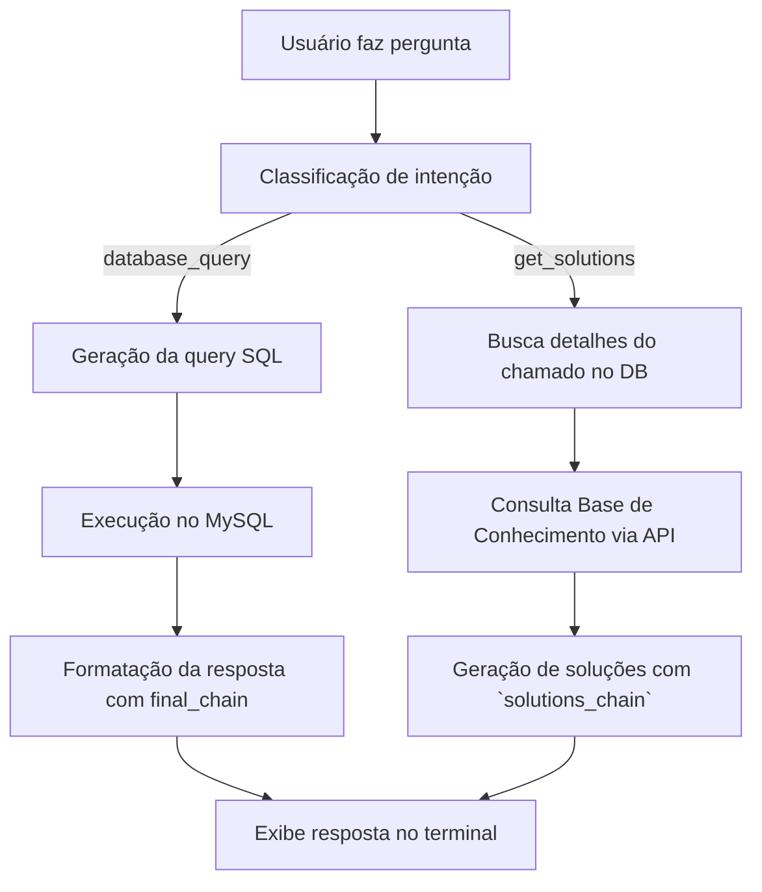

-----

# 🤖 GLPI SQL AI

Um **assistente de IA** que entende perguntas em **linguagem natural** sobre o banco de dados **GLPI**, gera a **query SQL automaticamente**, executa-a e responde em **português natural** — tudo direto no seu **terminal**.

-----

## 📖 Sumário

  * [✨ Funcionalidades](https://www.google.com/search?q=%23-funcionalidades)
  * [🧠 Arquitetura de Chains](https://www.google.com/search?q=%23-arquitetura-de-chains)
  * [🏗️ Estrutura do Projeto](https://www.google.com/search?q=%23%EF%B8%8F-estrutura-do-projeto)
  * [🛠️ Tecnologias Utilizadas](https://www.google.com/search?q=%23%EF%B8%8F-tecnologias-utilizadas)
  * [⚙️ Instalação e Configuração](https://www.google.com/search?q=%23%EF%B8%8F-instala%C3%A7%C3%A3o-e-configura%C3%A7%C3%A3o)
  * [🚀 Como Usar](https://www.google.com/search?q=%23-como-usar)
  * [🧩 Fluxo da Aplicação](https://www.google.com/search?q=%23-fluxo-da-aplica%C3%A7%C3%A3o)
  * [💡 Exemplos de Perguntas](https://www.google.com/search?q=%23-exemplos-de-perguntas)
  * [🤝 Como Contribuir](https://www.google.com/search?q=%23-como-contribuir)
  * [📄 Licença](https://www.google.com/search?q=%23-licen%C3%A7a)

-----

## ✨ Funcionalidades

  * 💬 **Consultas em Linguagem Natural**
    Faça perguntas como “quantos chamados atrasados existem?” — e receba respostas completas sem escrever uma linha de SQL.

  * 🧩 **Classificação Automática de Intenção**
    O modelo entende se você quer **consultar dados** ou **gerar soluções para um chamado específico**.

  * 📚 **Integração com a Base de Conhecimento GLPI**
    Enriquece as sugestões de solução com artigos e tutoriais diretamente da sua `Knowbase` do GLPI, fornecendo contexto do mundo real.

  * 🧠 **Engenharia de Prompt Avançada**
    Inclui um “Dicionário de Termos de Negócio” e um mapa detalhado das tabelas do GLPI, garantindo queries mais precisas e contextualizadas.

  * 🧱 **Arquitetura Modular e Escalável**
    O código é dividido em módulos independentes — `config`, `prompts`, `chains`, `services`, `knowledge_base` e `main` — seguindo padrões de boas práticas em Python.

  * 🔌 **Integração com o GLPI**
    Totalmente adaptado à estrutura de dados do sistema de chamados GLPI (MySQL) e sua API REST para a Base de Conhecimento.

-----

## 🧠 Arquitetura de Chains

| Chain                   | Função                                                               | Entrada                                  | Saída                               |
| ----------------------- | -------------------------------------------------------------------- | ---------------------------------------- | ----------------------------------- |
| 🧩 `sql_chain`          | Gera o código SQL a partir da pergunta do usuário                    | Pergunta natural                         | Query SQL pura                      |
| 🧠 `final_chain`        | Converte o resultado do banco em resposta natural                    | Resultado SQL                            | Texto em português                  |
| 💡 `solutions_chain`    | Gera soluções, **priorizando** o contexto da Base de Conhecimento    | Detalhes do chamado + Contexto da KB     | Lista de soluções                   |
| 🎯 `intent_classifier_chain` | Determina o tipo de pergunta (consulta ou solução)                 | Pergunta natural                         | “database\_query” ou “get\_solutions” |

-----

## 🏗️ Estrutura do Projeto

```
glpi-sql-ai/
├── .env                       # Configurações de ambiente (chaves, DB, GLPI API)
├── pyproject.toml             # Dependências e metadata do Poetry
└── src/
    └── glpi_sql_ai/
        ├── __init__.py
        ├── config.py            # Conexão com DB, LLM e KB
        ├── prompts.py           # Definição dos templates de prompts
        ├── chains.py            # Construção das LangChains
        ├── knowledge_base.py    # Módulo de acesso à Base de Conhecimento do GLPI
        ├── services.py          # Lógica de negócio e orquestração
        └── main.py              # Loop principal da aplicação (chat interativo)
```

-----

## 🛠️ Tecnologias Utilizadas

  * 🐍 **Python 3.11+**
  * 📦 **Poetry** — gerenciamento de pacotes e ambientes virtuais
  * 🧠 **LangChain** — orquestração de prompts e execução das chains
  * 🤖 **OpenAI GPT-3.5-Turbo** — modelo de linguagem principal
  * 🗄️ **MySQL** — banco de dados do GLPI
  * 🌐 **Requests** — para comunicação com a API REST do GLPI
  * 🌿 **dotenv** — gerenciamento seguro de variáveis de ambiente

-----

## ⚙️ Instalação e Configuração

### 1\. Pré-requisitos

  * Python 3.11+
  * Poetry instalado
  * Acesso a um banco GLPI MySQL ativo
  * Acesso à API REST do GLPI com um token de usuário

-----

### 2\. Clonar o Repositório

```bash
git clone https://github.com/seu-usuario/glpi-sql-ai.git
cd glpi-sql-ai
```

-----

### 3\. Instalar as Dependências

```bash
poetry install
```

-----

### 4\. Configurar o Ambiente

Crie um arquivo `.env` na raiz com:

```env
# Chave da OpenAI
OPENAI_API_KEY="sua_chave_aqui"

# Credenciais do Banco de Dados
DB_HOST="localhost"
DB_NAME="glpi"
DB_USER="root"
DB_PASSWORD="senha"

# Credenciais da API do GLPI (para Base de Conhecimento)
GLPI_URL="http://seu-glpi/glpi"
GLPI_USER_TOKEN="seu_token_de_usuario_api"
```

-----

## 🚀 Como Usar

Inicie a aplicação com:

```bash
poetry run python -m glpi_sql_ai.main
```

### Exemplo de Sessão:

```
▶️  Iniciando a aplicação...
✅ 152 artigos da Base de Conhecimento carregados.
================================================================================
🤖 Olá! Sou seu assistente de banco de dados GLPI.
   Faça uma pergunta sobre os chamados ou digite 'sair' para terminar.
================================================================================
Você: quantos chamados atrasados existem?
🤔 Analisando sua pergunta...
🤖 Assistente: Existem atualmente 48 chamados atrasados no setor de TI.
--------------------------------------------------------------------------------
Você: soluções para o chamado 1205
🤔 Analisando sua pergunta...
📚 Buscando informações na base de conhecimento...
💡 Gerando soluções para o chamado 1205...

💡 Soluções Sugeridas:
De acordo com a base de conhecimento:
**Artigo 1:** Problemas de Conexão de Impressora de Rede
1. Verifique o cabo de rede e o ponto de conexão.
2. Tente pingar o endereço IP da impressora a partir do computador do usuário.
3. Reinicie o spooler de impressão no Windows (services.msc).
...
--------------------------------------------------------------------------------
Você: sair
🤖 Até a próxima!
```

-----

## 🧩 Fluxo da Aplicação



-----

## 💡 Exemplos de Perguntas

| Tipo           | Exemplo                                         |
| -------------- | ----------------------------------------------- |
| 🔍 Consultas   | “Quantos chamados estão abertos?”               |
| 📊 Ranking     | “Top 5 técnicos com mais chamados solucionados” |
| ⏰ Atrasos     | “Quantos chamados atrasados existem este mês?”  |
| 👨‍💻 Técnicos   | “Chamados do técnico Mateus Sousa”              |
| 🧯 Soluções    | “Soluções para o chamado 2331”                  |

-----

## 🤝 Como Contribuir

1.  Faça um fork do projeto
2.  Crie uma branch para sua feature:
    ```bash
    git checkout -b feature/nova-funcionalidade
    ```
3.  Faça o commit das mudanças:
    ```bash
    git commit -m "feat: adiciona nova funcionalidade"
    ```
4.  Envie o PR 🎉

-----

## 📄 Licença

Distribuído sob a licença **MIT**.
Sinta-se livre para usar, modificar e contribuir\!

-----