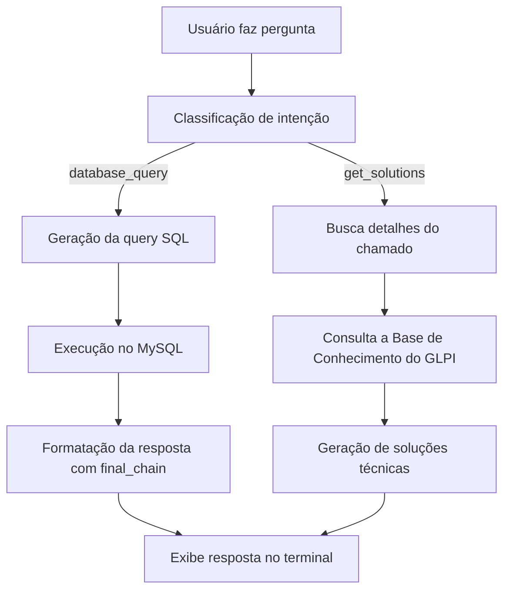

---

```markdown
# 🤖 GLPI SQL AI

Um **assistente de IA interativo** que entende perguntas em **linguagem natural** sobre o banco de dados **GLPI**, gera a **query SQL automaticamente**, executa-a e responde em **português natural** — tudo direto no seu **terminal**.

Além disso, o sistema é capaz de **sugerir soluções técnicas inteligentes** para chamados específicos, combinando **informações da base de conhecimento do GLPI (API REST)** com o raciocínio do modelo de linguagem.


---

## 📖 Sumário

* [✨ Funcionalidades](#-funcionalidades)
* [🧠 Arquitetura de Chains](#-arquitetura-de-chains)
* [🏗️ Estrutura do Projeto](#️-estrutura-do-projeto)
* [🛠️ Tecnologias Utilizadas](#️-tecnologias-utilizadas)
* [⚙️ Instalação e Configuração](#️-instalação-e-configuração)
* [🚀 Como Usar](#-como-usar)
* [🧩 Fluxo da Aplicação](#-fluxo-da-aplicação)
* [💡 Exemplos de Perguntas](#-exemplos-de-perguntas)
* [🤝 Como Contribuir](#-como-contribuir)
* [📄 Licença](#-licença)

---

## ✨ Funcionalidades

* 💬 **Consultas em Linguagem Natural**
  Faça perguntas como “quantos chamados atrasados existem?” — e receba respostas completas sem escrever uma linha de SQL.

* 🧩 **Classificação Automática de Intenção**
  O modelo entende se você quer **consultar dados do banco** ou **gerar soluções para um chamado específico**.

* 🧠 **Integração com a Base de Conhecimento do GLPI (API REST)**
  Conecta-se automaticamente à base de conhecimento, busca artigos relevantes e combina as informações com a resposta da IA.

* 💡 **Geração de Soluções Técnicas Inteligentes**
  A IA interpreta o contexto de um chamado (prioridade, impacto, urgência, categoria) e propõe **3 a 5 soluções práticas e acionáveis**.

* 🔐 **Configuração Segura com `.env`**
  Todas as credenciais (API Key, DB, GLPI Token) são gerenciadas de forma isolada e segura.

* 🧱 **Arquitetura Modular e Escalável**
  Código dividido em módulos independentes — `config`, `prompts`, `chains`, `services`, `knowledge_base` e `main` — seguindo boas práticas de engenharia.

---

## 🧠 Arquitetura de Chains

| Chain                        | Função                                             | Entrada                  | Saída                               |
| ---------------------------- | -------------------------------------------------- | ------------------------ | ----------------------------------- |
| 🧩 `sql_chain`               | Gera o código SQL a partir da pergunta do usuário  | Pergunta natural         | Query SQL pura                      |
| 🧠 `final_chain`             | Converte o resultado do banco em resposta natural  | Resultado SQL            | Texto em português                  |
| 💡 `solutions_chain`         | Gera soluções técnicas para chamados específicos   | ID + detalhes do chamado | Lista de soluções                   |
| 🎯 `intent_classifier_chain` | Determina o tipo de pergunta (consulta ou solução) | Pergunta natural         | “database_query” ou “get_solutions” |

---

## 🏗️ Estrutura do Projeto

```

glpi-sql-ai/
├── .env                      # Configurações de ambiente (chaves e DB)
├── pyproject.toml            # Dependências e metadata do Poetry
└── src/
└── glpi_sql_ai/
├── **init**.py
├── config.py         # Conexão com o MySQL, LLM e Base de Conhecimento GLPI
├── knowledge_base.py # Busca e processamento de artigos da Base de Conhecimento via API REST
├── prompts.py        # Definição dos templates de prompts e dicionário de regras SQL
├── chains.py         # Montagem das LangChains e funções auxiliares de execução
├── services.py       # Lógica de negócio: classificação, queries e soluções
└── main.py           # Loop principal do chatbot interativo no terminal

````

---

## 🛠️ Tecnologias Utilizadas

* 🐍 **Python 3.11+**
* 📦 **Poetry** — gerenciamento de pacotes e ambientes virtuais
* 🧠 **LangChain** — orquestração de prompts e execução das chains
* 🤖 **OpenAI GPT-3.5-Turbo** — modelo de linguagem principal
* 🗄️ **MySQL** — banco de dados GLPI
* 🌿 **dotenv** — gerenciamento seguro de variáveis de ambiente
* 🔗 **GLPI API REST** — integração direta com a base de conhecimento

---

## ⚙️ Instalação e Configuração

### 1. Pré-requisitos

* Python 3.11+
* Poetry instalado
  ```bash
  pip install poetry
````

* Acesso a um banco de dados GLPI MySQL ativo

---

### 2. Clonar o Repositório

```bash
git clone https://github.com/seu-usuario/glpi-sql-ai.git
cd glpi-sql-ai
```

---

### 3. Instalar as Dependências

```bash
poetry install
```

---

### 4. Configurar o Ambiente

Crie um arquivo `.env` na raiz com:

```env
OPENAI_API_KEY="sua_chave_aqui"

DB_HOST="localhost"
DB_NAME="glpi"
DB_USER="root"
DB_PASSWORD="senha"

GLPI_URL="http://localhost/glpi"
GLPI_USER_TOKEN="seu_token_aqui"
```

> ⚠️ Se `GLPI_URL` ou `GLPI_USER_TOKEN` não forem definidos, o sistema ainda funcionará,
> mas as soluções não terão contexto da base de conhecimento.

---

## 🚀 Como Usar

Inicie a aplicação com:

```bash
poetry run python -m glpi_sql_ai.main
```

### Exemplo de Sessão:

```
▶️  Iniciando a aplicação...
================================================================================
🤖 Olá! Sou seu assistente de banco de dados GLPI.
   Faça uma pergunta sobre os chamados ou digite 'sair' para terminar.
================================================================================
Você: quantos chamados atrasados existem?
🤔 Analisando sua pergunta...
🤖 Assistente: Existem atualmente 48 chamados atrasados no setor de TI.
--------------------------------------------------------------------------------
Você: soluções para o chamado 1205
🔍 Buscando detalhes do chamado 1205...
📚 Buscando informações na base de conhecimento...
💡 Soluções Sugeridas:
1. Verificar logs de erro do equipamento.
2. Confirmar se o chamado está atribuído corretamente.
3. Reabrir o ticket se houver inconsistência no status.
--------------------------------------------------------------------------------
Você: sair
🤖 Até a próxima!
```

---

## 🧩 Fluxo da Aplicação



---

## 💡 Exemplos de Perguntas

| Tipo           | Exemplo                                         |
| -------------- | ----------------------------------------------- |
| 🔍 Consultas   | “Quantos chamados estão abertos?”               |
| 📊 Ranking     | “Top 5 técnicos com mais chamados solucionados” |
| ⏰ Atrasos      | “Quantos chamados atrasados existem este mês?”  |
| 👨‍💻 Técnicos | “Chamados do técnico Mateus Sousa”              |
| 🧯 Soluções    | “Soluções para o chamado 2331”                  |

---

## 🤝 Como Contribuir

1. Faça um fork do projeto
2. Crie uma branch para sua feature:

   ```bash
   git checkout -b feature/nova-funcionalidade
   ```
3. Faça o commit das mudanças:

   ```bash
   git commit -m "feat: adiciona nova funcionalidade"
   ```
4. Envie o PR 🎉

---

## 📄 Licença

Distribuído sob a licença **MIT**.
Sinta-se livre para usar, modificar e contribuir!

---

```

---

```
