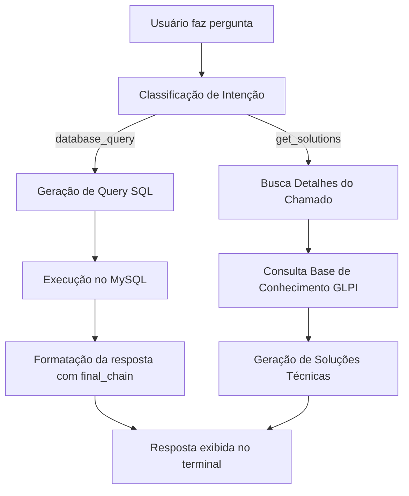

```markdown
# 🤖 GLPI SQL AI

Um **assistente de IA interativo** que entende perguntas em **linguagem natural** sobre o banco de dados **GLPI**, gera a **query SQL automaticamente**, executa-a e responde em **português natural** — tudo direto no terminal.

Além disso, o sistema é capaz de **sugerir soluções técnicas inteligentes** para chamados específicos, combinando informações do GLPI com a base de conhecimento.


---

## 📖 Sumário

- [Funcionalidades](#-funcionalidades)
- [Arquitetura de Inteligência](#-arquitetura-de-inteligência)
- [Estrutura do Projeto](#-estrutura-do-projeto)
- [Tecnologias Utilizadas](#-tecnologias-utilizadas)
- [Instalação e Configuração](#-instalação-e-configuração)
- [Como Usar](#-como-usar)
- [Fluxo da Aplicação](#-fluxo-da-aplicação)
- [Exemplos de Perguntas](#-exemplos-de-perguntas)
- [Como Contribuir](#-como-contribuir)
- [Licença](#-licença)

---

## ✨ Funcionalidades

💬 **Consultas em Linguagem Natural**
Faça perguntas como “quantos chamados atrasados existem?” e receba respostas completas — sem escrever SQL.

🧩 **Classificação Automática de Intenção**
O sistema entende se você quer **consultar dados do banco** ou **gerar soluções técnicas** para um chamado.

📚 **Integração com a Base de Conhecimento do GLPI (KB)**
Conecta-se via **API REST**, busca artigos relacionados e combina essas informações com o raciocínio da IA.

💡 **Geração de Soluções Inteligentes**
Com base nos detalhes de um chamado e no conteúdo da KB, o assistente propõe de **3 a 5 soluções técnicas** práticas.

🔐 **Configuração Segura por `.env`**
Mantém chaves e credenciais de forma isolada e segura.

🏗️ **Arquitetura Modular e Escalável**
Cada módulo tem uma função clara: configuração, prompts, chains, lógica de negócio e ponto de entrada.

---

## 🧠 Arquitetura de Inteligência

| Chain                        | Função                                                      | Entrada                     | Saída                                  |
| ---------------------------- | ------------------------------------------------------------ | --------------------------- | -------------------------------------- |
| 🧩 `sql_chain`               | Gera o código SQL a partir da pergunta                       | Pergunta em linguagem natural | Query SQL pura                         |
| 🧠 `final_chain`             | Converte a resposta SQL em português natural                 | Resultado SQL               | Texto formatado                        |
| 💡 `solutions_chain`         | Sugere soluções técnicas integrando GLPI + KB + LLM          | ID + detalhes do chamado    | Lista de soluções estruturadas         |
| 🎯 `intent_classifier_chain` | Classifica a intenção do usuário                             | Pergunta natural            | “database_query” ou “get_solutions”    |

---

## 🏗️ Estrutura do Projeto

```

glpi-sql-ai/
├── .env                        # Variáveis de ambiente (DB, tokens e API)
├── pyproject.toml              # Configurações e dependências do Poetry
└── src/
└── glpi_sql_ai/
├── config.py           # Conexão com MySQL, LLM e Base de Conhecimento
├── knowledge_base.py   # Integração com API REST do GLPI e busca de artigos
├── prompts.py          # Templates de prompts e instruções de sistema
├── chains.py           # Definição das LangChains e funções auxiliares
├── services.py         # Lógica de negócio (consultas, soluções e intents)
└── main.py             # Ponto de entrada e loop de chat interativo

````

---

## 🛠️ Tecnologias Utilizadas

* 🐍 **Python 3.11+**
* 📦 **Poetry**
* 🧠 **LangChain** — orquestração das LLM Chains
* 🤖 **OpenAI GPT-3.5-Turbo**
* 🗄️ **MySQL**
* 🌿 **dotenv**
* 🔗 **GLPI API REST**

---

## ⚙️ Instalação e Configuração

### 1️⃣ Pré-requisitos

- Python 3.11+
- Poetry instalado:
  ```bash
  pip install poetry
````

* Banco de dados GLPI ativo e acessível.

---

### 2️⃣ Clonar o Repositório

```bash
git clone https://github.com/seu-usuario/glpi-sql-ai.git
cd glpi-sql-ai
```

---

### 3️⃣ Instalar as Dependências

```bash
poetry install
```

---

### 4️⃣ Configurar o Ambiente

Crie o arquivo `.env` com:

```env
OPENAI_API_KEY="sua_chave_openai"

DB_HOST="localhost"
DB_NAME="glpi"
DB_USER="root"
DB_PASSWORD="senha"

GLPI_URL="http://localhost/glpi"
GLPI_USER_TOKEN="seu_token_glpi"
```

> ⚠️ Se `GLPI_URL` e `GLPI_USER_TOKEN` não forem definidos, o sistema ainda funciona,
> mas as soluções não terão contexto da base de conhecimento.

---

## 🚀 Como Usar

Inicie o chatbot:

```bash
poetry run python -m glpi_sql_ai.main
```

Exemplo:

```
▶️  Iniciando a aplicação...
================================================================================
🤖 Olá! Sou seu assistente de banco de dados GLPI.
   Faça uma pergunta sobre os chamados ou digite 'sair' para terminar.
================================================================================
Você: quantos chamados atrasados existem?
🤔 Analisando sua pergunta...
🤖 Assistente: Existem atualmente 48 chamados atrasados no setor de TI.
--------------------------------------------------------------------------------
Você: soluções para o chamado 1258
🔍 Buscando detalhes do chamado 1258...
📚 Buscando informações na base de conhecimento...
💡 Soluções Sugeridas:
1. Reiniciar o serviço relacionado.
2. Verificar logs de erro do equipamento.
3. Validar dependências do GLPI.
--------------------------------------------------------------------------------
Você: sair
🤖 Até a próxima!
```

---

## 🧩 Fluxo da Aplicação



---

## 💡 Exemplos de Perguntas

| Tipo            | Exemplo                                         |
| --------------- | ----------------------------------------------- |
| 🔍 Consultas    | “Quantos chamados estão abertos?”               |
| 📊 Ranking      | “Top 5 técnicos com mais chamados solucionados” |
| ⏰ Atrasos       | “Chamados atrasados este mês”                   |
| 👨‍💻 Técnicos  | “Chamados do técnico Mateus Sousa”              |
| 🧯 Soluções     | “Soluções para o chamado 2331”                  |
| 📚 Conhecimento | “Como resolver o erro de login no GLPI?”        |

---

## 🤝 Como Contribuir

1. Faça um fork do projeto
2. Crie uma branch:

   ```bash
   git checkout -b feature/nova-funcionalidade
   ```
3. Faça o commit:

   ```bash
   git commit -m "feat: adiciona nova funcionalidade"
   ```
4. Envie o PR 🎉

---

## 📄 Licença

Distribuído sob a licença **MIT**.
Sinta-se livre para usar, modificar e contribuir!

---
